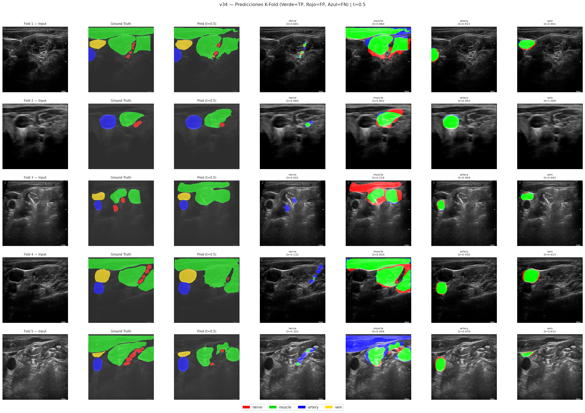

# Multi-structure Segmentation of Anatomical Structures in Brachial Plexus Ultrasound Images (UBPD)

[](https://colab.research.google.com/github/ryuuisdead/ubpd-multiclass-segmentation/blob/main/notebookubpd_v34_kfold_colab.ipynb)
[](https://opensource.org/licenses/MIT)
[](https://pytorch.org/)
[](#architecture)

This repository contains the complete experimental code, cross-validation protocol, and evaluation artifacts for the paper:

> **"Modelo para la segmentación multiestructura de estructuras anatómicas en imágenes de ultrasonido del plexo braquial"**  
> *Jesús Alejandro Colmenero Sotelo, Julieta Guadalupe Rodríguez Ruiz, Alejandro Mauricio González, María del Refugio Rodríguez Ruiz, Sodel Vázquez Reyes* (2026).

---

## 📌 Overview

Automated segmentation of nerves, muscles, arteries, and veins in brachial plexus ultrasound is challenging due to speckle noise, low soft-tissue contrast, reverberations, and severe inter-patient variability. 

This project implements a reproducible, **patient-disjoint 5-Fold GroupKFold** evaluation on 955 image-annotation pairs (88 patients) from the **Ultrasonic Brachial Plexus Dataset (UBPD)**.

### Key Methodological Highlights:
- **Architecture**: UNet++ with ImageNet-pretrained ResNet-34 encoder and concurrent spatial and channel squeeze & excitation (`scSE`) decoder attention (26,275,495 parameters).
- **Leakage-Free Validation**: Strict **5-Fold GroupKFold** where patient intersection between training and validation is strictly zero ($0$). Normalization statistics (`mean`, `std`) and class frequencies are computed **strictly from the training fold**.
- **Composite Loss**: $0.50 \cdot L_{\text{FocalTversky}} + 0.30 \cdot L_{\text{FocalBCE}} + 0.20 \cdot L_{\text{Boundary}}$.
- **Reproducible Inference**: Fixed decision threshold $t = 0.5$ (without per-class threshold searches or temperature scaling to prevent calibration overfitting).
- **Test-Time Augmentation (TTA)**: Horizontal flip ensembling.

---

## 📊 Summary of Experimental Results (v34 K-Fold)

### Global Performance (Macro Mean across 5 Folds)

| Configuration | Dice (Macro) | IoU (Macro) | Precision | Recall | HD95 approx (px) | Pixel Accuracy |
| :--- | :---: | :---: | :---: | :---: | :---: | :---: |
| **Base ($t=0.5$)** | $0.6499 \pm 0.0447$ | $0.4877 \pm 0.0510$ | $0.6386 \pm 0.0520$ | $0.6907 \pm 0.0447$ | $89.21 \pm 15.20$ | $0.9708 \pm 0.0024$ |
| **TTA-hflip ($t=0.5$)** | **$0.6513 \pm 0.0455$** | **$0.4893 \pm 0.0519$** | **$0.6497 \pm 0.0558$** | $0.6832 \pm 0.0451$ | **$87.17 \pm 15.15$** | **$0.9712 \pm 0.0026$** |

### Class-Wise Metrics (with TTA-hflip, $t=0.5$)

| Anatomical Structure | Dice | IoU | Precision | Recall | HD95 approx (px) |
| :--- | :---: | :---: | :---: | :---: | :---: |
| **Nerve (Nervio)** | $0.6027 \pm 0.0490$ | $0.4331 \pm 0.0506$ | $0.7421 \pm 0.0348$ | $0.5094 \pm 0.0590$ | $65.82 \pm 19.30$ |
| **Muscle (Músculo)** | $0.6313 \pm 0.0251$ | $0.4618 \pm 0.0269$ | $0.5735 \pm 0.0427$ | $0.7064 \pm 0.0366$ | $99.40 \pm 7.00$ |
| **Artery (Arteria)** | $0.6598 \pm 0.0531$ | $0.4948 \pm 0.0622$ | $0.6229 \pm 0.0783$ | $0.7144 \pm 0.0819$ | $92.28 \pm 17.46$ |
| **Vein (Vena)** | $0.7113 \pm 0.1347$ | $0.5674 \pm 0.1480$ | $0.6602 \pm 0.1784$ | $0.8025 \pm 0.0773$ | $91.17 \pm 29.36$ |
| **Macro Average** | **$0.6513 \pm 0.0455$** | **$0.4893 \pm 0.0519$** | **$0.6497 \pm 0.0558$** | $0.6832 \pm 0.0451$ | **$87.17 \pm 15.15$** |
> *Note on HD95*: HD95 is computed on resized $384 \times 384$ px masks with an explicit 300 px penalty on one-sided misses ($HD95^*$). It measures spatial discrepancy and detection failure rate rather than physical distance in millimeters.

---

## 🖼️ Qualitative Results

Representative predictions across all 5 folds evaluated at $t=0.5$:



*Comparison between Ground Truth and UNet++ predictions across validation folds.*

---

## 📁 Repository Structure

```text
├── notebookubpd_v34_kfold_colab.ipynb   # Complete training, cross-validation & evaluation notebook
├── revision_analysis_colab.py           # Analysis script for patient bootstrap CI, sensitivity & metrics
├── results_v34/                         # All quantitative evaluation files and generated plots
│   ├── diagnostic_v34.txt               # Plaintext summary of configuration and metrics
│   ├── analysis_data_v34.json           # Raw per-class and per-fold metric arrays
│   ├── fold_results_v34.json            # Full per-fold metrics (Base & TTA)
│   ├── kfold_histories_v34.json         # Epoch-wise training and validation histories
│   ├── boxplot_dice_v34.png             # Dice distribution per image and structure
│   ├── strategy_comparison_v34.png      # Base vs TTA comparison per fold
│   ├── precision_recall_heatmap_v34.png # Precision-recall tradeoff per fold and class
│   ├── radar_chart_v34.png              # Multi-metric radar representation
│   ├── metrics_by_class_v34.png         # Bar plot of metrics by anatomical class
│   ├── training_curves_v34.png          # Loss and Dice training trajectories
│   └── predictions_comparison_v34.png   # Qualitative visual predictions
├── .gitignore                           # Git ignore rules (ignores heavy checkpoints and docs)
├── LICENSE                              # MIT License
└── README.md                            # Project documentation
```

---

## 🚀 How to Run

### In Google Colab
1. Click the **[Open in Colab](https://colab.research.google.com/github/ryuuisdead/ubpd-multiclass-segmentation/blob/main/notebookubpd_v34_kfold_colab.ipynb)** badge.
2. Select an **A100 GPU** or **T4 GPU** runtime.
3. Mount Google Drive and verify your dataset paths (`JPEGImages/` and `json_train/`).
4. Execute the cells sequentially.

### Environment & Dependencies
- Python >= 3.10
- PyTorch >= 2.1
- `segmentation-models-pytorch == 0.5.0`
- `albumentations == 2.0.8`
- `scikit-learn == 1.6.1`
- `opencv-python == 4.10.x`

---

## 📖 Citation

If you use this code or findings in your research, please cite:

```bibtex
@inproceedings{colmenero2026ubpd,
  title     = {Modelo para la segmentaci{\'o}n multiestructura de estructuras anat{\'o}micas en im{\'a}genes de ultrasonido del plexo braquial},
  author    = {Colmenero Sotelo, Jes{\'u}s Alejandro and Rodr{\'i}guez Ruiz, Julieta Guadalupe and Gonz{\'a}lez, Alejandro Mauricio and Rodr{\'i}guez Ruiz, Mar{\'i}a del Refugio and V{\'a}zquez Reyes, Sodel},
  booktitle = {Coloquio Internacional de Investigaci{\'o}n InterCiencias},
  year      = {2026}
}
```

---

## 📄 License
This repository is licensed under the [MIT License](LICENSE).
